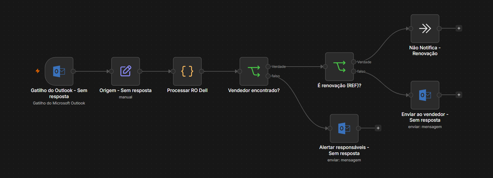

# Notificação Automática de Registro de Oportunidade Submetido

Workflow n8n que monitora a caixa de e-mail, identifica quando um Registro de Oportunidade (RO) é submetido ao fabricante e avisa automaticamente o vendedor responsável com um e-mail formatado.

## Problema

Quando um registro de oportunidade era submetido, o fabricante enviava a confirmação para uma caixa compartilhada. Alguém precisava ler cada e-mail, descobrir de qual vendedor era a oportunidade e repassar a informação manualmente, o que gerava atraso e esquecimentos.

## Solução

1. O gatilho do Outlook verifica a caixa a cada minuto e filtra apenas os e-mails do remetente do fabricante.
2. Um nó Code converte o HTML do e-mail em texto e extrai número do RO, cliente, vendedor e produto a partir do padrão `Cliente | Vendedor | Produto` no nome da oportunidade.
3. O nome do vendedor é normalizado (sem acentos, maiúsculas ou espaços extras) e comparado com uma lista de vendedores.
4. Renovações (identificadas pelo código `REF:`) são ignoradas, pois já têm um fluxo próprio.
5. O vendedor recebe um e-mail HTML com os dados do RO. Se o vendedor não for encontrado, a equipe recebe um alerta em vez de o e-mail ir para a pessoa errada.

## Destaques técnicos

- **Sem envios duplicados:** o fluxo guarda os ROs já processados em `$getWorkflowStaticData` por até 365 dias e descarta reenvios do mesmo RO.
- **Modo de teste seguro:** em execuções manuais a deduplicação é desligada, permitindo testar o mesmo e-mail várias vezes sem afetar o histórico de produção.
- **Correspondência tolerante a variações:** aceita apelidos e nomes com ou sem sobrenome, acento ou maiúsculas.
- **Segurança no HTML:** todos os dados vindos do e-mail passam por escape antes de entrar no corpo da mensagem.
- **Falha segura:** quando não há certeza sobre o vendedor, nada é enviado ao vendedor e a equipe é alertada.

## Tecnologias

Nós utilizados: Microsoft Outlook Trigger · Set · Code · IF · Microsoft Outlook · No Operation

## Como usar

1. No n8n, abra **… → Import from File** e selecione `workflow.json`.
2. Configure a credencial do Microsoft Outlook no gatilho e nos dois nós de envio.
3. No gatilho, ajuste o filtro de remetente para o endereço que envia as confirmações.
4. No nó **Processar RO Dell**, edite a lista `vendedores` com os nomes e e-mails da sua equipe.
5. Ajuste os destinatários em cópia e o endereço de alerta (`@empresa.example`).
6. Troque a URL do logo (`example.com/imagens/...`) e ative o workflow.

> Nomes, e-mails, logos e credenciais foram substituídos por dados fictícios.
